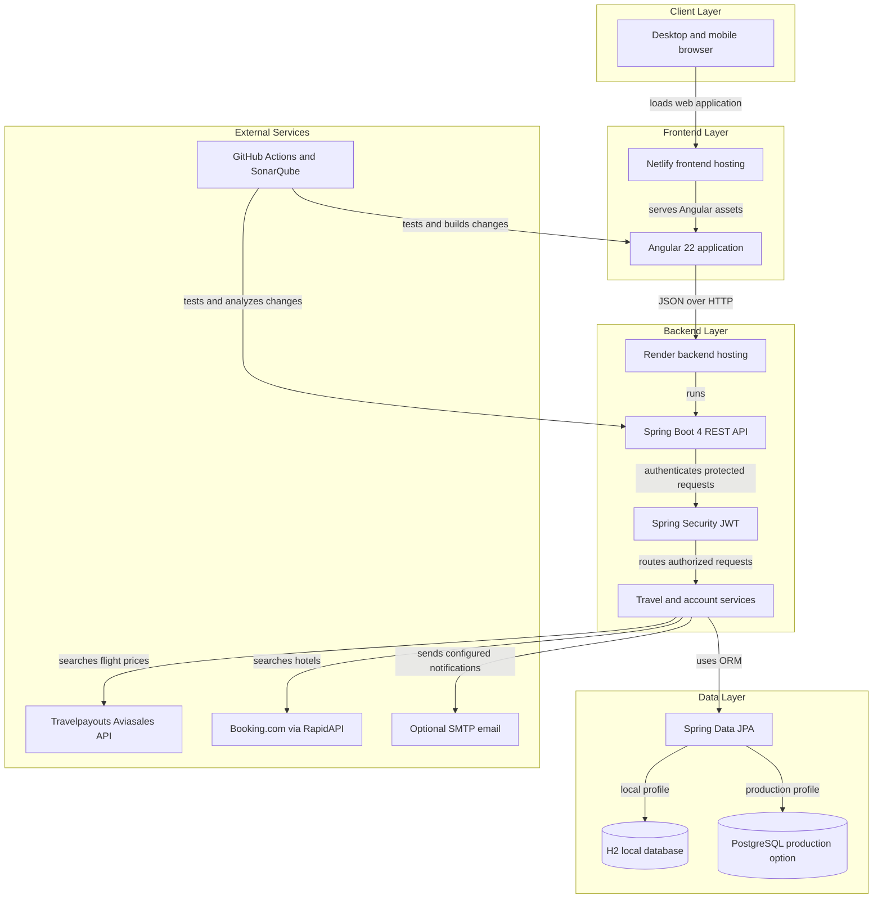
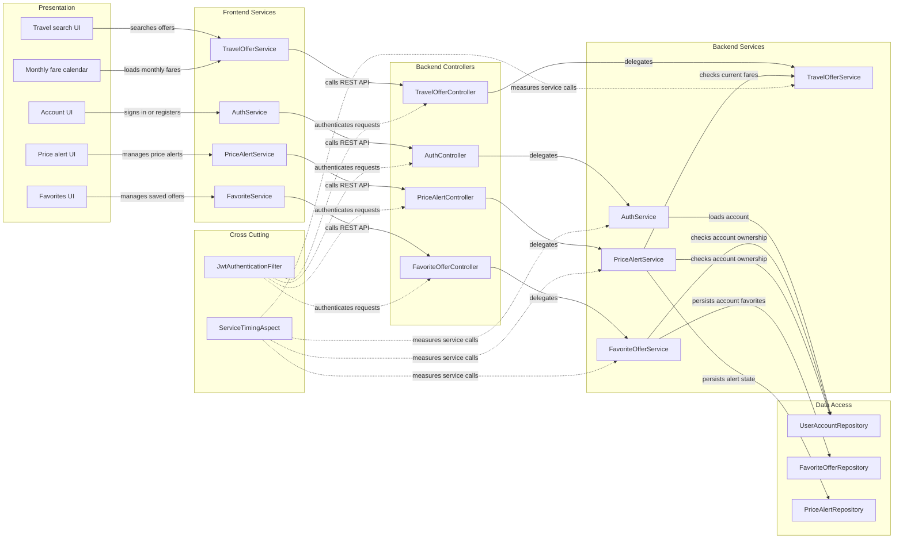

# Architecture Diagram

Voyageo is a French-language travel comparison application with an Angular client and a Spring Boot REST API. The diagrams show the current application boundaries and how authenticated account features flow through the frontend and backend.

## Application Architecture

<!-- mermaid-checked: no \n, no em-dash/en-dash, no {} in labels, subgraphs are id["label"], arrows are -->|"label"|, all subgraphs closed by end, ids unique -->

### Technology Stack Summary

| Layer | Technology | Version | Purpose |
|---|---|---|---|
| Frontend | Angular | 22 | Search, account, favorites, price alerts, and flexible-date UI |
| Frontend language | TypeScript | 6 | Typed client application |
| Frontend reactive APIs | RxJS | 7.8 | HTTP request and event streams |
| Backend | Spring Boot | 4.0.0 | REST API, dependency injection, scheduling, and configuration |
| Backend language | Java | 21 | API and business logic |
| Persistence | Spring Data JPA | Managed by Spring Boot | Relational persistence and repositories |
| Local database | H2 | Managed by Spring Boot | Local development and test persistence |
| Production database option | PostgreSQL | Driver configured | Persistent production storage when a datasource is provided |
| CI and analysis | GitHub Actions and SonarQube or SonarCloud | Workflow actions | Tests, builds, and optional static analysis |
| Hosting | Netlify and Render | Hosted services | Frontend delivery and backend execution |

### Data Storage & External Services

Spring Data JPA stores accounts, favorites, and price alerts. H2 is the default local database; PostgreSQL can be selected through datasource environment variables, but a hosted database must be provisioned and connected separately. The travel service calls Travelpayouts Aviasales for flight prices and Booking.com through RapidAPI for hotel offers. SMTP email is optional; account notifications remain in Voyageo when SMTP is not configured.

### Key Architectural Decisions

- The backend separates HTTP controllers, business services, and persistence repositories; JWT authentication protects account-specific operations.
- An AOP aspect measures service execution time without logging method arguments.
- Provider credentials, datasource values, mail settings, and analysis tokens are supplied through environment variables or CI secrets rather than source code.

## Component Relationships

<!-- mermaid-checked: no \n, no em-dash/en-dash, no {} in labels, subgraphs are id["label"], arrows are -->|"label"|, all subgraphs closed by end, ids unique -->

### Component Inventory

| Component | Layer | Type | Responsibility |
|---|---|---|---|
| Travel search UI | Presentation | Angular component | Collects travel search criteria and displays offers |
| Monthly fare calendar | Presentation | Angular component | Displays provider-returned monthly fares and emits a selected date |
| Account UI | Presentation | Angular component | Provides login, registration, and profile interactions |
| Favorites UI | Presentation | Angular component | Saves offers locally or to the signed-in account |
| Price alert UI | Presentation | Angular component | Creates and manages account price alerts |
| TravelOfferService | Frontend Services | Angular service | Requests offers, destination suggestions, and monthly fares |
| AuthService | Frontend Services | Angular service | Manages authentication requests and client session state |
| FavoriteService | Frontend Services | Angular service | Calls account favorite endpoints |
| PriceAlertService | Frontend Services | Angular service | Calls price alert endpoints |
| TravelOfferController | Backend Controllers | REST controller | Exposes travel search, autocomplete, and monthly price routes |
| AuthController | Backend Controllers | REST controller | Exposes account registration, login, and current-user routes |
| FavoriteOfferController | Backend Controllers | REST controller | Exposes authenticated favorite operations |
| PriceAlertController | Backend Controllers | REST controller | Exposes authenticated price alert operations |
| TravelOfferService | Backend Services | Business service | Searches external travel providers and maps offers |
| AuthService | Backend Services | Business service | Creates accounts and authenticates credentials |
| FavoriteOfferService | Backend Services | Business service | Applies account ownership and favorite persistence rules |
| PriceAlertService | Backend Services | Business service | Manages alert state and scheduled fare checks |
| UserAccountRepository | Data Access | Spring Data repository | Loads and persists account records |
| FavoriteOfferRepository | Data Access | Spring Data repository | Loads and persists saved offers |
| PriceAlertRepository | Data Access | Spring Data repository | Loads and persists alert records |
| JwtAuthenticationFilter | Cross Cutting | Security filter | Validates bearer tokens and establishes request identity |
| ServiceTimingAspect | Cross Cutting | AOP aspect | Measures service execution time without logging arguments |
